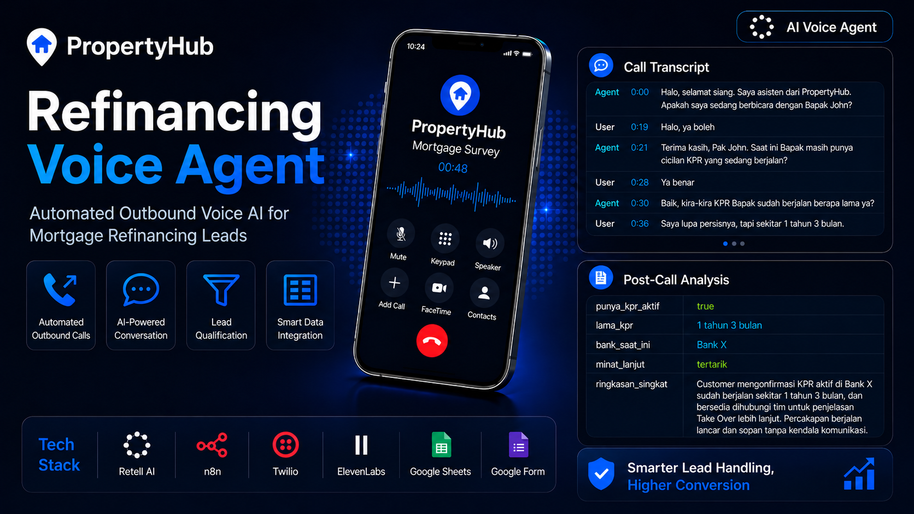
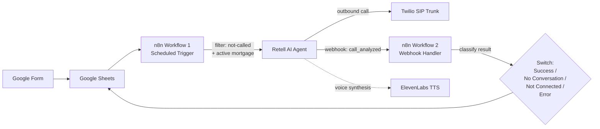

# Refinancing Voice Agent

<p align="center">
  
</p>

An automated outbound voice AI system that calls mortgage refinancing leads, asks a short set of qualifying questions, and routes interested leads to a human sales team.

Independent portfolio project. The company name used throughout ("PropertyHub") is a fictional placeholder.

## Demo

- **Call transcript & Post-Call Analysis:** [`evidence/call-transcript-sample.md`](evidence/call-transcript-sample.md)
- **n8n workflow exports:** [`workflows/`](workflows/)

## Architecture



**Flow summary:**
1. A lead fills out a Google Form; responses land in Google Sheets with a `not-called` status.
2. **Workflow 1** polls the sheet every 5 minutes, picks up one unqualified lead at a time (rate-limited to avoid concurrent outbound calls and reduce spam-flagging risk), and triggers a call via the Retell AI API.
3. The **Retell agent** (GPT-4.1, custom Bahasa Indonesia voice via ElevenLabs) asks four qualifying questions with branching logic for 12+ edge cases (voicemail, wrong number, off-topic requests, objections, etc.).
4. Once the call ends, Retell sends a `call_analyzed` webhook to **Workflow 2**, which classifies the outcome into one of four categories (successful qualifying conversation, connected with no real conversation, not connected, or system error) based on call status, disconnection reason, and transcript content, then writes the result back to the sheet, with failed calls automatically eligible for retry on the next polling cycle.

## Tech Stack & Key Decisions

| Component | Choice | Why |
|---|---|---|
| Voice orchestration | Retell AI | Best-in-class turn-taking and telephony orchestration |
| TTS | ElevenLabs | Higher-quality Indonesian voice than Retell's built-in options |
| Conversation model | GPT-4.1 (non-reasoning) | Low latency matters more than deep reasoning for a 4-question qualifying script |
| Post-call analysis model | GPT-5.4 Nano | Structured extraction from a finished transcript doesn't need a large model |
| Telephony | Twilio, SIP Trunking | Twilio number bridges Retell (VoIP) to the real PSTN network |
| Workflow engine | n8n, split into 2 workflows | Scheduled polling and reactive webhook handling have fundamentally different trigger lifecycles |

## Repository Structure

```
├── README.md
├── docs/
│   ├── google-form-sheets-design.md   # Form/sheet schema and filter logic
│   ├── n8n-workflow-architecture.md   # Node-by-node breakdown of both workflows
│   ├── post-call-analysis-schema.md   # Custom analysis field definitions
│   └── system-prompt.md               # Full Retell agent system prompt
├── evidence/
│   ├── call-transcript-sample.md
│   └── retell-agent-config-summary.md
└── workflows/
    ├── workflow-1-outbound-trigger.json
    └── workflow-2-call-result-handler.json
```

The workflow JSON files above have gone through a redaction process, sensitive values like credential IDs, spreadsheet ID, and webhook ID are replaced with placeholders such as `YOUR_GOOGLE_SHEET_ID`. Replace these with your own values before importing these workflows into n8n.

## Known Limitations

- Currently uses a US-based Twilio number for outbound calls (routing to Indonesian mobile numbers). An Indonesian local number was evaluated but not pursued for this portfolio version, due to its recurring monthly cost being disproportionate for a non-production demo project.
- Not load-tested beyond a handful of manual test calls.
